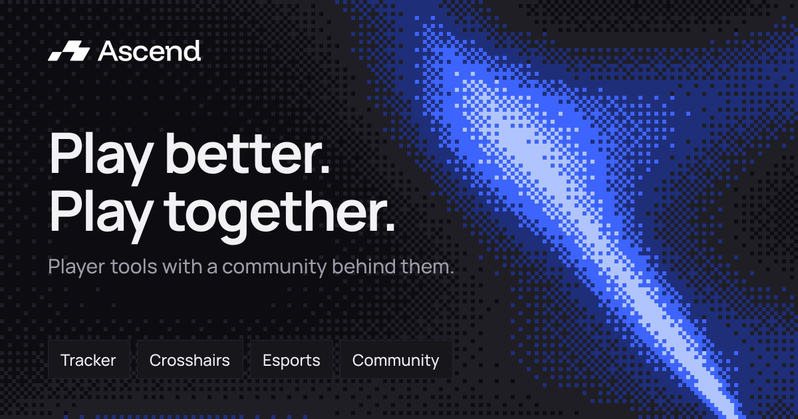
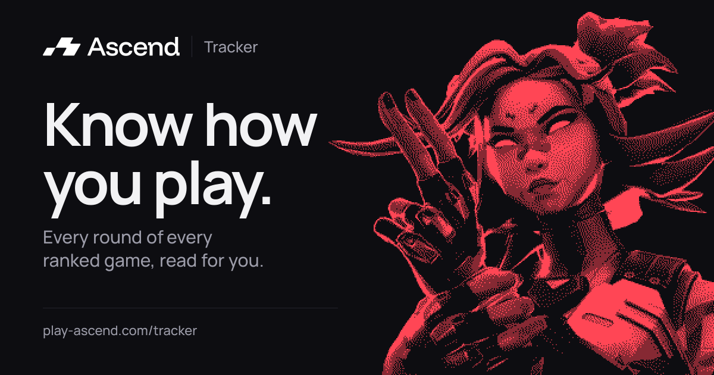
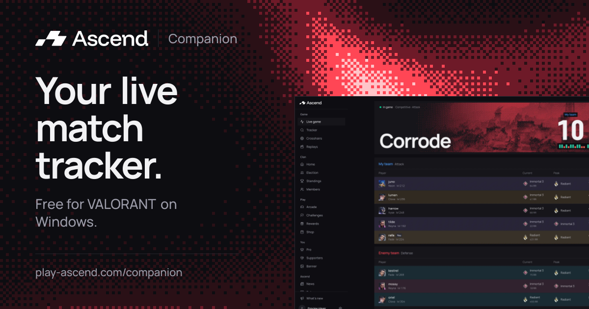
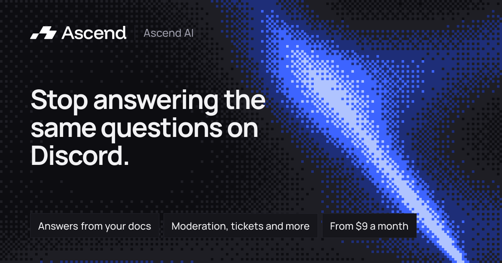

  

## Free VALORANT player tools, with a community behind them

Play Ascend makes tools for VALORANT players and the communities they play in. Look up any Riot ID, see where you stand on your region's leaderboard, grab a pro's crosshair, follow the esports scene, and hang out with the Ascend community on Discord.

<table>
  <tr>
    <td width="50%" valign="top">
      
      <h3>Tracker</h3>
      Match history, ranked progress and regional leaderboards for any Riot ID.
       <a href="https://www.play-ascend.com/tracker">Open the tracker</a>
    </td>
    <td width="50%" valign="top">
      
      <h3>Ascend Companion</h3>
      A free Windows app with the tools and the community in one window. It reads only what your game client shares: no memory reading, no injection.
       <a href="https://www.play-ascend.com/companion">Get Companion</a>
    </td>
  </tr>
  <tr>
    <td width="50%" valign="top">
      
      <h3>Ascend AI</h3>
      A Discord bot that answers a server's repeat questions from its own docs and hands the rest to its mods. Moderation, tickets and more as opt-in modules.
       <a href="https://www.play-ascend.com/ascend-ai-bot">Add Ascend AI</a>
    </td>
    <td width="50%" valign="top">
      <h3>Also from Play Ascend</h3>
      <ul>
        <li><a href="https://www.play-ascend.com/crosshairs">Crosshair gallery</a>: pro and community codes, add your own</li>
        <li><a href="https://esports.play-ascend.com">Esports</a>: results, teams and player stats</li>
        <li><a href="https://www.play-ascend.com/blog">Blog</a>: product notes and guides</li>
        <li><a href="https://community.play-ascend.com">Ascend community</a>: our Discord server</li>
      </ul>
    </td>
  </tr>
</table>

### Connect

[Website](https://www.play-ascend.com) · [Discord](https://community.play-ascend.com) · [X](https://x.com/play_ascend) · [Instagram](https://www.instagram.com/play_ascend/) · info@play-ascend.com

Play Ascend is independent and is not endorsed by Riot Games. VALORANT is a trademark of Riot Games, Inc.
